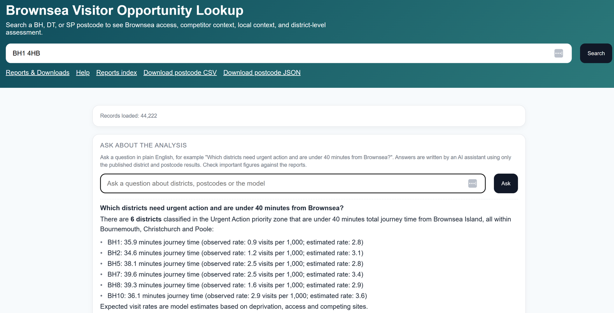

# Brownsea Visitor Access & Equity Model

This project looks at who visits Brownsea Island and who doesn't, and what might be keeping people away, so that outreach can be aimed at the areas that would benefit most. It groups every postcode district in the BH, DT and SP areas by how much need there is locally and how often residents visit, so that high-need areas with few visits stand out. A model then estimates the visit rate each district would be expected to have, given its deprivation, how long the journey to Brownsea takes, and whether there is another National Trust site closer to home that residents might choose instead. Comparing that with actual visits shows where a district falls short.

**Live app with AI assistant:** https://brownsea-visitor-access.onrender.com

**Static version (no assistant):** https://rollinse.github.io/brownsea-visitor-access-equity-model/

The first link is on a free hosting plan, so the first load can take about a minute.

**About this version.** This is a public, data-safe copy of a tool I built for the National Trust. It contains no visitor or member records. Everything shown here is summarised at postcode-district level, so no individual or household can be identified. Shared with the National Trust's agreement.



## What you can do with it

* Look up any of 44,222 postcodes and see the journey to Brownsea (drive plus ferry), the nearest competing National Trust site, local deprivation, and how the surrounding district is doing.
* See how the 48 districts are grouped into five priority zones, from Urgent Action to Maintain, each with a suggested type of intervention.
* Read the [reports](https://rollinse.github.io/brownsea-visitor-access-equity-model/reports/index.html) and download the results as CSV.
* Ask the AI assistant about the data, or what a term means and how the analysis was done (hosted version only).

Journey times are planning estimates, not live travel times.

## How it works

1. **Data.** Each district is described by ten features: the total journey time to Brownsea, the drive time to the nearest competing National Trust site, the free school meal rate, and deprivation measures from the IMD (overall, income, geographical barriers and wider barriers, plus the share of residents living in the most, moderately and least deprived areas). Drive times come from OpenRouteService.
2. **Model.** Seven model types were compared: Ridge, Poisson GLM, random forest, gradient boosting, XGBoost, LightGBM and CatBoost, with and without tuning, plus an ensemble of the best three. They are trained on the 48 districts in the study area and scored with cross-validation grouped by local authority, so each district is predicted by a model that has not seen its authority. Ridge regression performed best, with a mean absolute error of 1.16 visits per 1,000 residents and an R² of 0.67. The full comparison is in the [model performance report](https://rollinse.github.io/brownsea-visitor-access-equity-model/reports/model_performance.html).
3. **Classification.** Each district gets a need score: 70% from the share of residents in the most deprived areas (IMD deciles 1 to 4) and 30% from the free school meal rate. The need score and the observed visit rate together decide the priority zone. For example, high need with fewer than 4 visits per 1,000 residents is Urgent Action. The model's expected rate is shown alongside, with SHAP values to show which features raise or lower it for each district.
4. **Outputs.** The pipeline writes a postcode lookup, a district table and a set of HTML reports. Both apps read these files.

## The two apps

| | Static app | Flask app |
|---|---|---|
| Where | GitHub Pages | Render |
| Needs a server | No | Yes |
| Postcode lookup and reports | Yes | Yes |
| AI assistant | No | Yes |

The assistant needs a server to keep its API key private, so it is only in the Flask app.

## AI assistant

The Flask app has an "Ask about the analysis" box. You can ask things like "Which districts need urgent action and are under 40 minutes from Brownsea?" or "What does Urgent Action mean?" and get a short written answer.

The assistant is an LLM agent built on Google's Gemini API. It doesn't answer from memory. For each question it picks from a small set of read-only tools, the tools look up the published results, and the model writes its answer from what comes back.

| Tool | Reads |
|---|---|
| `lookup_postcode` | the postcode lookup |
| `get_district`, `query_districts`, `aggregate_districts` | the district table |
| `get_model_performance` | the model comparison |
| `get_definitions` | the priority zone and need tier definitions |
| `search_documentation` | the help page, the model report notes and this README |

* Counts, totals and averages are worked out in Python by the tools, not by the model.
* The tools only read the published postcode and district outputs. The assistant never sees visitor or member records.
* Each answer lists which data it used.

### Searching the documentation

Questions about numbers go to the data tools. Questions about meaning or method, such as "how was the model tested?", go to `search_documentation`, a small retrieval (RAG) step over the help page, the model report notes and parts of this README.

The text is split into short passages, and each question is matched against them in two ways: by keyword (BM25) and by embedding similarity, using Gemini's embedding model. The two rankings are then combined with reciprocal rank fusion. Keywords alone miss questions that are worded differently from the text, such as "tested" when the passage says "cross-validation". If the embedding call fails, search falls back to keywords. The assistant answers from the passages it gets back and says where they came from.

### Settings

Gemini's free tier has low daily limits per model, so if one model is over its limit or busy, the assistant moves on to the next one in the list.

| Setting | Default | Purpose |
|---|---|---|
| `GEMINI_API_KEY` | none | Turns the assistant on |
| `BROWNSEA_AGENT_MODEL` | `gemini-3.8-flash` | First model to try |
| `BROWNSEA_AGENT_FALLBACK_MODELS` | `gemini-3.7-flash,gemini-3.6-flash,gemini-3.5-flash,gemini-3.5-flash-lite` | Models to fall back to, in order |
| `BROWNSEA_AGENT_RATE_PER_MIN` | `10` | Questions allowed per client per minute |
| `BROWNSEA_EMBEDDINGS` | `1` | Set to `0` to search the documentation by keyword only |
| `BROWNSEA_EMBEDDING_MODEL` | `gemini-embedding-001` | Embedding model for documentation search |
| `BROWNSEA_JUDGE_MODEL` | the first agent model | Model used as the judge in the evaluation |

### Evaluating the assistant

`scripts/eval_agent.py` asks the assistant a fixed set of 18 questions: questions about the data, questions about terms and method, and questions it should decline or say it can't answer. Each answer is checked in two ways.

* **Exact checks.** Where a question has one right answer, such as a count or a district, the script works it out from the district table and looks for it in the reply.
* **LLM as a judge.** A second model lists every factual claim in the answer and checks each one against what the assistant had to go on: its tool results and the short background on the analysis it's given. Pass or fail is then decided in code, and any unsupported claim is a fail. The judge also checks that off-topic questions are declined, and that questions the data can't answer (member numbers, past years) get "I can't answer that" rather than a guess.

A judge can get things wrong too, so I tested it before relying on its scores. `evals/judge_check.jsonl` holds 18 answers paired with real tool results. Fifteen I wrote by hand, about half with a planted mistake: a wrong number, a wrong district, an invented reason, or a made-up reply to an off-topic question. The other three are answers the assistant gave in evaluation runs, two wrong and one right. `--check-judge` runs the judge over them and reports how many bad answers it let through and how many good ones it failed. It also helps to use a different model as the judge (`BROWNSEA_JUDGE_MODEL`), since a model tends to go easy on its own writing.

Each run is saved with the tool results, so the answers can be judged again later with `--rejudge` without asking the assistant again.

**Latest results (27 November 2026)**

* The judge agreed with all 18 labelled answers in the check set.
* All 9 exact checks passed.
* None of the 18 answers contained an unsupported claim.
* The judge passed 17 of the 18. The one it failed was "What was the visit rate for BH1 in 2019?". The assistant said there are no figures by year and then gave BH1's current rate. That's a reasonable reply, but the judge didn't count it as declining the question.

Most of the judging was done by `gemini-3.5-flash-lite`, as the other free models were busy at the time.

## Run it yourself

The app runs straight after cloning, using the results published in `docs/`.

```bash
git clone https://github.com/RollinsE/brownsea-visitor-access-equity-model.git
cd brownsea-visitor-access-equity-model
pip install -r requirements/app.txt
python run_postcode_app.py
```

Then open http://localhost:8000.

To turn on the assistant, get a free key from https://aistudio.google.com/apikey and set it before starting the app:

```bash
export GEMINI_API_KEY=your-key
```

On Windows, use `$env:GEMINI_API_KEY="your-key"` in PowerShell or `set GEMINI_API_KEY=your-key` in Command Prompt.

You can also ask a question from the command line, or run the evaluation described above:

```bash
python -m src.agent --show-tools "How many districts are in each priority zone?"
python scripts/eval_agent.py
python scripts/eval_agent.py --check-judge
```

The hosted version is deployed on Render from `render.yaml`.

## Rebuilding the analysis

The pipeline runs in five stages: data preparation, model training, framework definitions, analysis and reports, and the postcode lookup. It needs the private visit data, so it cannot be rerun from this repository alone. The commands, release checks and Colab notes are in [PIPELINE.md](PIPELINE.md).

## Repository layout

```text
├── app/                 # Flask app
├── assets/              # Images for this README
├── data/reference/      # Public reference data
├── docs/                # Static app and published results (GitHub Pages)
├── evals/               # Hand-labelled answers for checking the LLM judge
├── notebooks/           # Colab notebooks
├── requirements/        # Dependency files
├── scripts/             # QA, release and export scripts
├── src/                 # Pipeline and app code
│   └── agent/           # AI assistant: tools, retrieval, judge and LLM connections
├── tests/
├── cli.py               # Pipeline entry point
├── render.yaml          # Hosting config for Render
└── run_postcode_app.py  # Starts the Flask app
```

## Data and privacy

The original tool was built using private visitor and member data. None of that data is in this repository or in either live app. The public version only includes the summarised outputs of the analysis, public reference data and the code.

## Tests

```bash
pytest
```

## License

The code is under the MIT License. The private and raw datasets are not part of this repository and are not covered by it.
